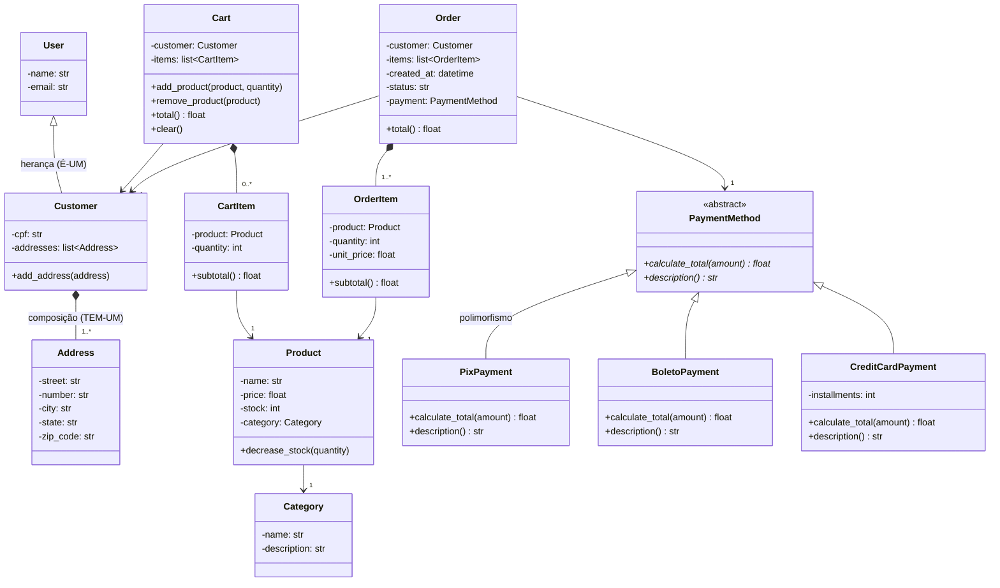

# 🧩 Diagrama de classes (produto final esperado)

Este é o modelo que vamos construir até a Aula 7. O GitHub desenha o diagrama automaticamente a partir do código Mermaid abaixo.

## Legenda

| Símbolo | Significado |
|---|---|
| `-` | atributo privado/protegido (em Python: `_atributo`) |
| `+` | público |
| `<|--` | herança: `Customer` **é um** `User` |
| `*--` | composição: a parte não existe sem o todo |
| `<<abstract>>` / `*` | classe abstrata / método abstrato (as subclasses são obrigadas a implementar) |
| `-->` | associação: um objeto conhece/usa o outro |
